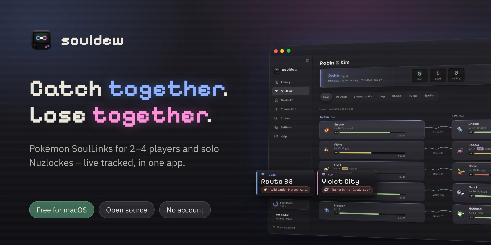
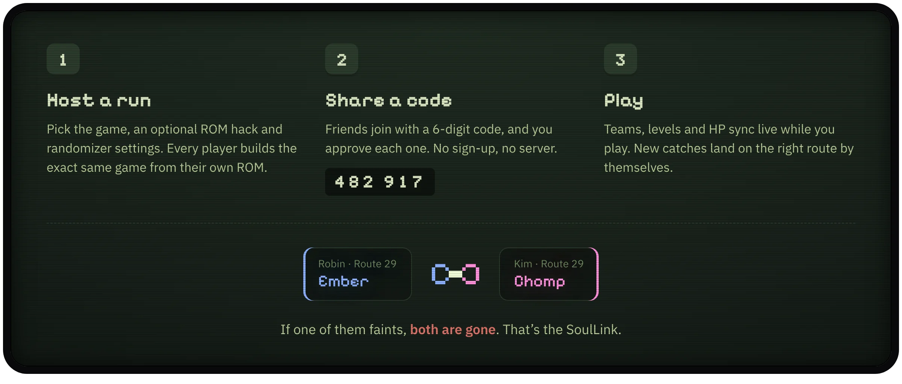
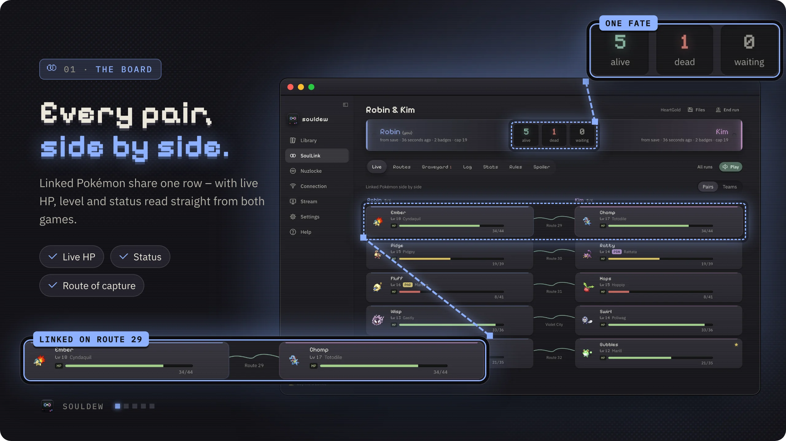
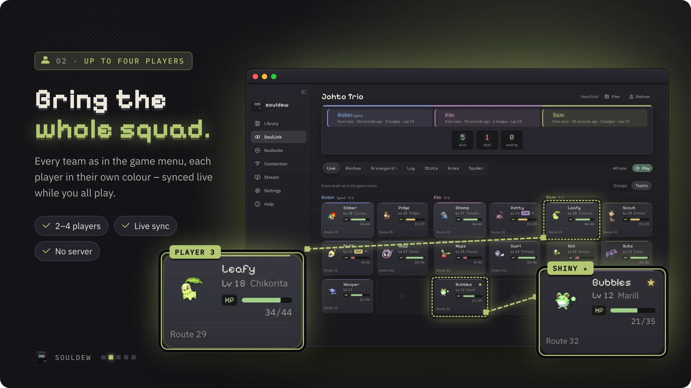
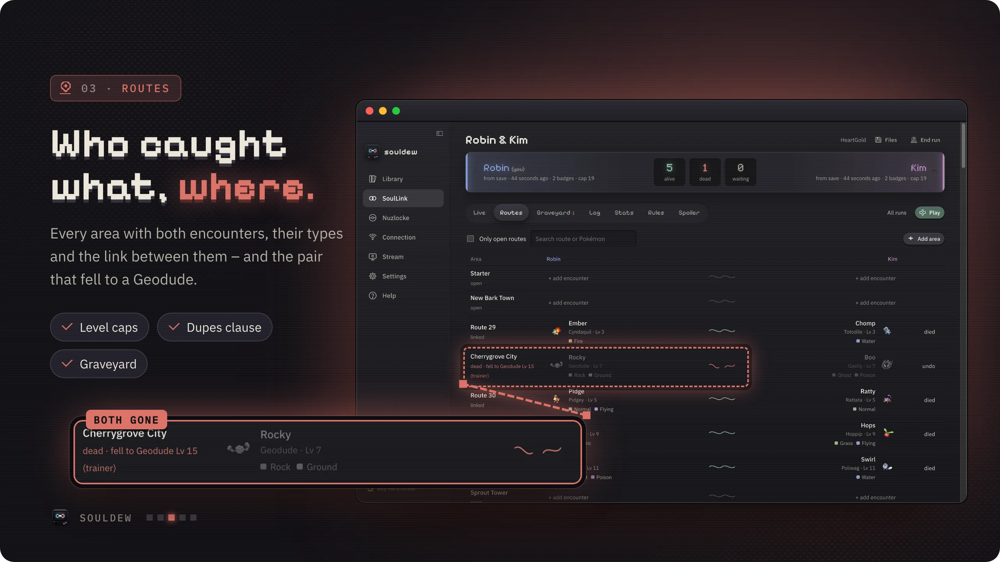
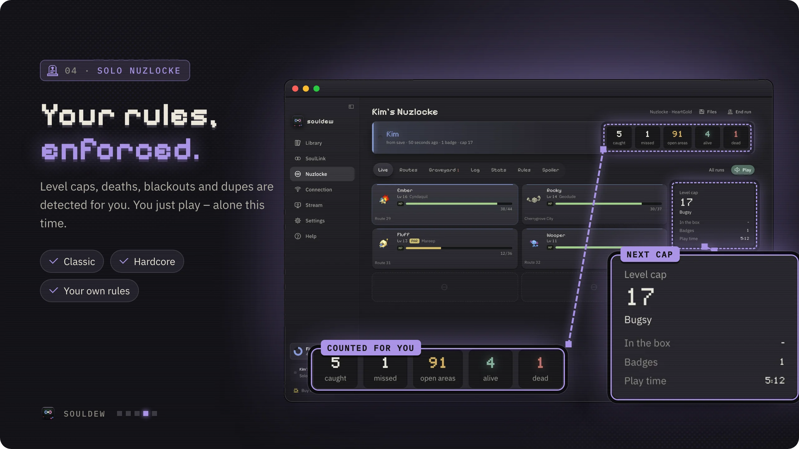
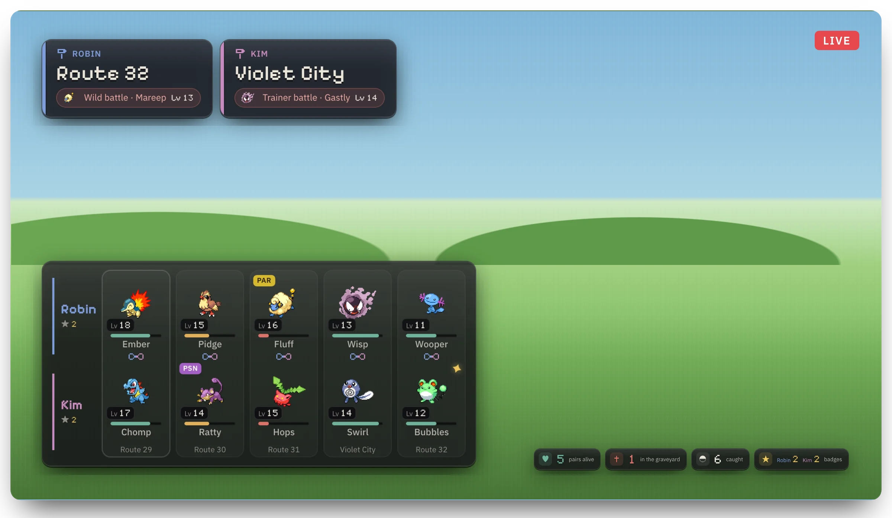
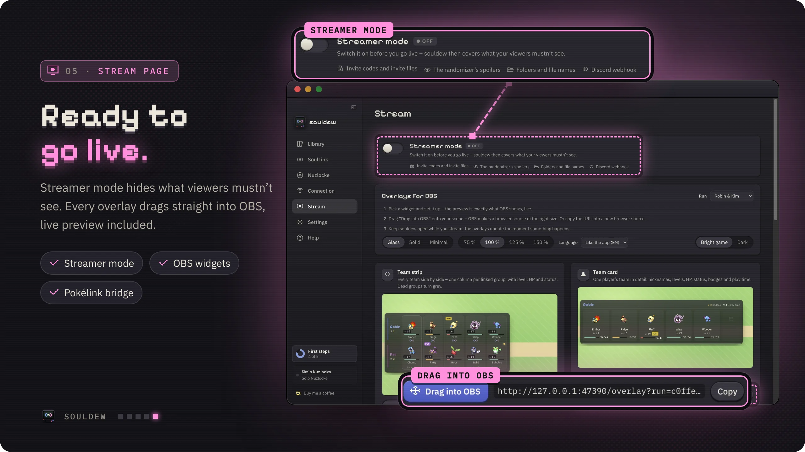

  

  
  
  
  
  
  

  <b><a href="https://github.com/souldewapp/souldew/releases/latest">Download for macOS, Windows &amp; Linux</a></b> ·
  <a href="https://souldewapp.github.io/souldew/">Website</a> ·
  <a href="#how-a-soullink-works">How it works</a> ·
  <a href="#a-look-inside">Screenshots</a> ·
  <a href="#made-for-streaming">Streaming</a> ·
  <a href="#faq">FAQ</a> ·
  <a href="https://github.com/souldewapp/souldew/issues/new/choose">Report a bug</a>

**souldew** is a free app for macOS, Windows and Linux (Steam Deck included) for Pokémon SoulLinks with 2–4 players and solo Nuzlockes. It bundles your game library, a built-in emulator, the Universal Pokémon Randomizer, ROM-hack patching, live tracking straight from the running game and real-time sync with your friends – no server, no account, no spreadsheet. The look borrows from the Game Boy and the PS1, boot animation included.

> [!NOTE]
> souldew contains **no games**. You play your own, legally obtained ROMs – see [Legal](#legal).

## How a SoulLink works

A SoulLink is a Nuzlocke for two or more: whatever you catch on a route is bound to what your partners catch there. souldew does the bookkeeping – you just play.

<b>Step by step: playing together</b>

1. **One person hosts:** SoulLink › **Host a new SoulLink**, choose "SoulLink · 2/3/4" and enter everyone's names. Pick the game (and optionally a hack) and a randomizer preset.
2. **Invite with a code:** the app shows a 6-digit code (valid for 15 minutes). Tell it to the next player; when they ask to join, you click **Allow**. Each code lets exactly one person in – "New code" makes the next one. An invite file works too.
3. **The others join:** install the app, add their **own** ROM (and patch) to the library, then SoulLink › **Join with code**. The name you enter there is the name the others see.
4. Everyone clicks **Play** on the board. The apps connect by themselves and the teams appear live on every board. If a Pokémon faints, the whole group of that area dies.

**How does that work without a server?** The apps find each other through public [Nostr](https://nostr.com) relays (via [Trystero](https://github.com/dmotz/trystero)) and then talk directly over WebRTC. If a router blocks that, data goes through a public MQTT broker instead. Everything is encrypted with the key from the invite (invite codes use a slow key derivation and a confirmation step, so a code alone never reveals the run), and only tracker data is sent – never ROMs or saves.

## Everything in one app

Emulator, tracker, rules, randomizer and sync live in the same place – and they talk to each other.

<table>
<tr>
<td width="50%" valign="top"> <b>Built-in emulator</b> DS, GBA, Game Boy and Game Boy Color. 1–4× speed, eight save states, controllers – and the game keeps running in a mini window while you check the board.</td>
<td width="50%" valign="top"> <b>Live tracking</b> Your team is read straight from game memory: species, nickname, level, HP, status and where it was caught. No typing things in.</td>
</tr>
<tr>
<td width="50%" valign="top"> <b>Battle panel</b> The opponent’s types and weaknesses, how your moves land – and whether your rules even allow the catch, including type clashes with your partners.</td>
<td width="50%" valign="top"> <b>Real-time sync</b> Up to four players, directly over WebRTC or through an encrypted relay. Your partner’s game shows up as a small live picture next to yours.</td>
</tr>
<tr>
<td width="50%" valign="top"> <b>Randomizer & ROM hacks</b> Universal Pokémon Randomizer ZX is built in, Java included. xdelta, BPS, UPS and IPS patches are applied for you, with 31 known hacks ready to go.</td>
<td width="50%" valign="top"> <b>Solo Nuzlocke</b> Classic, Hardcore or your own rules. Level caps, dupes and shiny clause, deaths and blackouts detected automatically – and a graveyard that remembers who did it.</td>
</tr>
<tr>
<td width="50%" valign="top"> <b>Turbo without chipmunk music</b> Fast-forward through the grind while the music keeps playing at normal speed. For DS games souldew plays the current song from your ROM’s own sound archive.</td>
<td width="50%" valign="top"> <b>Made for everyone</b> English, German, French, Spanish and Italian. Colour-blind safe schemes, full keyboard control and reduced motion.</td>
</tr>
</table>

<b>Every feature in detail</b>

| Area | What it does |
|---|---|
| **Library** | Your games as cartridges in their console's real shape (Game Boy cart, GBA cart, DS card) with full box art for 46 Pokémon games (GB, GBC, GBA, DS, including German releases). ROMs are recognised by header and CRC32, also inside zips. **Search my Mac** scans Downloads, Desktop, Documents, iCloud Drive, folders like "Games"/"ROMs" and the OpenEmu library – it only reads file names and headers. 31 known ROM hacks with description and difficulty (no links to them); patches (xdelta, BPS, UPS, IPS) are applied by the app. Games without a picture can get a custom cover. Everything in your library can be saved back to a file (ROM, patched hack, patch, save) – the app downloads no games. |
| **Play** | Built-in emulator ([EmulatorJS](https://emulatorjs.org) 4.2.3): melonDS for DS, DeSmuME for HeartGold/SoulSilver and Black/White, mGBA for GBA, Gambatte for GB/GBC. The game **keeps running when you open other sections** – it shrinks to a mini window. Speed 1–4× (optionally a "Max" step without any limit, Settings), 8 save-state slots with thumbnails plus automatic "where you left off" backups, DS screens stacked or side by side, screenshots, fullscreen with an auto-hiding sidebar. Controllers: PlayStation, Xbox, Switch and third-party pads via USB or Bluetooth, with Nintendo or Xbox button layout and full remapping. The app warns when in-game progress hasn't been saved yet. |
| **Turbo music** | While fast-forwarding, the music keeps playing at normal speed and follows the scene. For DS games souldew reads the sound archive (SDAT) from your ROM and plays the current song itself; for other games it loops music recorded at 1×. Sound effects are muted (configurable: the emulator's own fast-forward sound, silence, or "Plain" – the emulator's own sound with no extra processing). |
| **Live tracking** | Reads your team straight from the running game's memory: species, nickname, level, HP, status condition and where it was caught. New catches are filed under their route automatically. **In battle** the left column shows the opponent (types, HP, shiny/legendary), how your moves land, what hits you, both Pokémon's weaknesses and whether your rules allow the catch (type rule, dupes clause, shiny clause – including "your partner already has this primary type here"). A linked Pokémon at 0 HP kills the whole group at once, and everyone gets a big notice. If a player's whole team faints, the run ends for everyone. |
| **"You are here"** | A sign next to the game shows where you are ("Route 29", "New Bark Town"), read live from the game, and what that area means for each player ("first encounter open", "caught: Pidgey", "area used up", "dead"). |
| **Board** | All teams as in the game menu – as linked pairs/groups or side-by-side team views (up to 4 players, each in their colour), with live HP. Route list with level caps (HeartGold/SoulSilver incl. Definitive HG), graveyard with cause of death, log with chat and ping, **stats** (catch rate, deaths per boss segment, deadliest opponents, longest survivor), rules, spoiler log. Runs can be ended (failed or won), resumed, and retried as a "new attempt" with the same settings and a new seed. |
| **Live sync** | Teams travel to the others in real time while you play (up to 3 partners) – directly via WebRTC or through an encrypted relay. No server or account of your own needed. The partner's game shows as a small live video (direct connection) or a still image every 1.5 s (relay); sharing can be switched off. |
| **Randomizer** | [Universal Pokémon Randomizer ZX](https://github.com/Ajarmar/universal-pokemon-randomizer-zx) for Gen 1–5 with a fixed seed. Every player builds a **byte-identical** game from their own ROM; the app compares the checksums. For Definitive HeartGold a helper works around the randomizer's crashes. A Java runtime is bundled. |
| **External emulators** | melonDS and mGBA can be chosen per system and installed with one click. mGBA streams live data through a bundled Lua script; melonDS syncs after every in-game save. |
| **Stream** | A streamer-mode switch that covers invite codes, folders/file names, the Discord webhook and the spoiler tab on every page. OBS overlays as individual widgets with live preview, their own URL and "Drag into OBS". A Pokélink-compatible bridge so existing Pokélink themes can show souldew's data. See [docs/STREAMING.md](docs/STREAMING.md). |
| **Cheats** | **Rare Candies** for level caps without grinding: "Add 99 Rare Candies" in the play screen's cheats menu writes them straight into the bag in game memory (Gen 1–5, randomized games too). Off until a run's rules allow cheats, and every use – and every change of that rule – shows up in the log for all players. |
| **Extras** | Discord webhook for run events; graveyard box (moves dead Pokémon in the save to box 18, with a backup); "Save diagnostics" (Help › Questions and the volume menu) writes a file of what the app read and decided – for bug reports, without ROM, save or invite data. |
| **Look & accessibility** | Five UI languages (English, German, French, Spanish, Italian). Four colour schemes: classic, high contrast, red-green safe and blue-yellow safe; body text meets 4.5:1 contrast in all of them, and dead/alive/waiting always carry a symbol too. Full keyboard navigation; "reduce motion" turns animations off. |

## A look inside

**The board** – linked pairs side by side, with live HP, status and the route they’re from.

**Up to four players** – every team as in the game menu, each player in their colour.

**Routes** – who caught what where, which areas are still open, and the pair that fell to a Geodude.

### Solo Nuzlocke

Playing alone? Nuzlocke › **New Nuzlocke** asks only for your name, the game, the randomizer and the rules.

- **Rules:** presets "Classic" (first encounter per area, fainted means dead, blackout ends the run, dupes and shiny clause) and "Hardcore" (plus strict level caps, no items in battle, "Set" battle style), or every rule on its own: blackout, deathless, dupes (species / evolution line), gifts & eggs and static encounters (count as the area / free extra / not allowed), type rule, nicknames, Pokémon Center visits per badge.
- **Detected automatically:** catches and their area, death at 0 HP with the opponent, blackout, level cap exceeded, a badge won above the cap, a second catch in a used-up area, a missing nickname; in battle: dupe, shiny (free catch), legendary.
- **Missed encounters:** when a wild battle ends without a catch, the app asks unobtrusively whether that used up an area.
- **Honour rules** (the app can't see your bag or the game options) are shown as reminders.

## Made for streaming

Every widget is a browser source for OBS – and it updates the moment a Pokémon is caught, levels up or dies.

- **Drag into OBS** – each widget lands as a browser source in exactly the right size: team strip, team card, counters, “You are here”, alerts and a stats bar.
- **Streamer mode** – one switch hides invite codes, file paths and randomizer spoilers on every page.
- **Pokélink bridge** – your existing Pokélink themes can show souldew’s data.
- **Overlay API** – a documented JSON snapshot and live event stream for your own tools.

All widgets, options, the API and the Pokélink setup: **[docs/STREAMING.md](docs/STREAMING.md)**.

## Supported games

Every main-series game from Red to White 2 plays in souldew. Live tracking reads these straight from memory:

| Generation | Games | Team & HP | Battle panel | “You are here” |
|---|---|:---:|:---:|:---:|
| Gen 1 | Red, Blue, Yellow | ✓ | ✓ | ✓ |
| Gen 2 | Gold, Silver, Crystal | ✓ | ✓ | ✓ |
| Gen 3 | Ruby, Sapphire, Emerald, FireRed, LeafGreen | ✓ | ✓ | ✓ |
| Gen 4 | Diamond, Pearl, Platinum, HeartGold, SoulSilver | ✓ | ✓ | ✓ |
| Gen 5 | Black, White, Black 2, White 2 | ✓ | memory search | ✓ |

English and German versions are supported for the team. “You are here” reads the place names from the game itself (Gen 3–5) or from souldew's tables (Gen 1/2): a randomized game or a ROM hack shows its own names. ROM hacks on the same engine as their base game work too – also with other Pokémon in the game (Light Platinum) or a moved memory layout (Crystal Legacy); hacks on an expanded GBA engine are searched for in memory (Run & Bun: team, battle and place sign work; others like Unbound or Radical Red say so when their team can't be found) – you can always enter catches by hand. Gen 1 and Gold/Silver store no catch location: a catch right after a wild battle is filed under the place the sign shows, anything else lands in an inbox to assign. Hacks that add the Fairy type or retype Pokémon (Renegade Platinum, Blaze Black 2 Redux) show the hack's types. Which games were checked in the running game, and how: **[docs/TESTED_GAMES.md](docs/TESTED_GAMES.md)**.

## Your games stay yours

<table>
<tr><td></td><td><b>No ROMs, no saves.</b> Only tracker data travels between players – never games or save files. souldew includes and downloads no games.</td></tr>
<tr><td></td><td><b>Encrypted by the invite.</b> Everything is encrypted with the key from your invite; a code alone never reveals your run.</td></tr>
<tr><td></td><td><b>No account, no telemetry.</b> No sign-up, no analytics. A diagnostics file is only written when you ask for one.</td></tr>
</table>

## Install

souldew runs on **macOS with Apple silicon (arm64)**, on **Windows 10 and 11 (x64)** and on **Linux (x64)** – the Steam Deck included. Players on different systems can play a SoulLink together.

**macOS**

1. Open `souldew-<version>-arm64.dmg` (from the [releases page](https://github.com/souldewapp/souldew/releases/latest), or `dist/` after building) and drag **souldew** into Applications.
2. First start: the app is only ad-hoc signed (not notarized by Apple), so macOS blocks it once. Open it, then go to **System Settings › Privacy & Security** and click **Open Anyway**. On older macOS versions, right-click the app › **Open** › **Open** works too.

**Windows**

1. Download `souldew-<version>-win-x64-setup.exe` from the [releases page](https://github.com/souldewapp/souldew/releases/latest) and run it. It installs souldew for your user account only (no admin rights needed), adds a Start menu and a desktop shortcut and starts the app.
2. First start: the installer isn't signed with a paid code-signing certificate, so **Microsoft Defender SmartScreen** may say "Windows protected your PC". Click **More info › Run anyway**. That is only needed for the downloaded installer – updates installed by the app itself don't ask again.
3. Uninstall it like any other app (Settings › Apps); your runs and saves are kept.

**Linux**

Two packages, both 64-bit (x86_64), from the [releases page](https://github.com/souldewapp/souldew/releases/latest):

- **AppImage** (`souldew-<version>-linux-x86_64.AppImage`) – one file that runs on almost every distribution and **updates itself**. Put it where you keep apps (e.g. `~/Applications`), make it executable (file manager: Properties › Permissions › *Allow executing as program*, or `chmod +x souldew-*.AppImage`) and double-click it. AppImages need FUSE 2: on Ubuntu 22.04 and newer install it once with `sudo apt install libfuse2t64` (22.04: `libfuse2`). Tools like Gear Lever or AppImageLauncher add it to your app menu.
- **.deb** (`souldew-<version>-linux-amd64.deb`) for Debian, Ubuntu, Linux Mint, Pop!_OS …: `sudo apt install ./souldew-<version>-linux-amd64.deb`. It adds souldew to the app menu. A package installed this way can't replace itself – when an update is out, the app links to the download page.

**Steam Deck:** in Desktop Mode, download the AppImage with the browser, move it to `~/Applications`, make it executable (Dolphin: right-click › Properties › Permissions › *Is executable*) and start it. For Game Mode, add it in Steam with **Games › Add a Non-Steam Game to My Library** (browse to the AppImage). Controllers work in the built-in emulator; the window fits the Deck's 1280×800 screen. "Search my PC" also looks in EmuDeck's and RetroDECK's ROM folders, on the internal drive and on the SD card. Updates replace the AppImage under its old name, so the Steam shortcut keeps working.

**Then, on every system:** the onboarding walks you through language, your name, the SoulLink rules, colour scheme and accessibility, controls and adding your games. At the end you pick: host a SoulLink, start a Nuzlocke, join with a code, or just look around. A "First steps" checklist then guides you to your first linked catch.

**Updates:** the app looks for a new version at start and every four hours. When there is one, the sidebar offers it; souldew downloads it, checks it and installs it on the next restart – your runs and saves stay where they are. You can also check by hand under **Settings › About**.

Nothing else to install: the emulator and the Java runtime for the randomizer ship with the app. Your data lives in `~/Library/Application Support/SoulLink Studio` on macOS, in `%APPDATA%\SoulLink Studio` on Windows and in `~/.config/SoulLink Studio` on Linux – the folder keeps the app's former name so runs and saves survived the rename.

<b>Keyboard shortcuts</b>

On Windows and Linux, use `Ctrl` where the table says `⌘` and `Shift` for `⇧` (the app shows the right keys under Help › Controls & shortcuts). Fullscreen for the window: `⌃⌘F` on macOS, `F11` on Windows and Linux. On Linux, `Alt` shows the menu bar.

| Key | Action |
|---|---|
| `Tab` (hold) | Fast-forward |
| `T` | Turbo 2× → 3× → 4× (→ Max) → off – steps your computer never reaches in that game are skipped |
| `P` | Pause |
| `F5` / `F8` | Save / load the selected save-state slot |
| `⇧1–4` / `1–4` | Save / load slot 1–4 |
| `F12` | Screenshot |
| `M` · `+` / `–` | Sound on/off · louder / quieter |
| `F` · `R` | Fullscreen · reset (asks first) |
| `⌘B` | Show / hide the sidebar |
| `⌘1–5` · `⌘O` | Library · SoulLink · Nuzlocke · Connection · Stream · add games |

In-game controls (default, change under **Settings › Controls**): arrow keys, Z = A, X = B, A = X, S = Y, Q/E = L/R, Enter = Start, V = Select, touch screen with the mouse. App shortcuts can't be bound to game buttons, so no key is used twice.

<b>Known limitations</b>

- **Packaged for macOS arm64, Windows x64 and Linux x64** (Windows on ARM runs the x64 build through emulation; no Linux ARM package yet). Neither is signed by Apple / with a Windows certificate, so macOS asks once on first start and SmartScreen may warn about the downloaded installer.
- **Linux** was tested on GitHub's Ubuntu runners (build, AppImage and .deb start, .deb install and removal, randomizer, emulator downloads) – please report anything that behaves differently on your distribution or desktop. The one-click melonDS and mGBA are AppImages too (FUSE 2 needed, see Install); emulators from your distribution (`mgba-qt`, `melonDS`) or Flathub are found as well – a Flatpak emulator may only see ROMs in folders it has access to. Where the system doesn't allow Chromium's sandbox (some distributions restrict user namespaces), the AppImage starts without it.
- **Windows** was tested on GitHub's Windows runners (build, install, start, uninstall, randomizer, emulator downloads) – please report anything that behaves differently on your PC. Windows paths with characters outside your system's code page (e.g. a Cyrillic user name on a German Windows) may trip up the Java randomizer.
- **Live tracking** was checked in a running game with HeartGold (US), Definitive HeartGold and Silver; the other generations and languages are covered by unit tests built on the pret disassemblies and the NDS Ironmon tracker.
- **HeartGold/SoulSilver and Black/White run on DeSmuME** instead of melonDS: EmulatorJS's melonDS core doesn't emulate these carts' infrared chip correctly ("A communication error has occurred" once a save exists).
- **Fast-forward on DeSmuME** (HeartGold/SoulSilver, Black/White) is limited by the computer: the built-in DS emulator runs on one CPU core, and HeartGold in town takes ~10 ms per frame on an M1 – about 1.6× there, lighter scenes 3–4×. No core option, frame skipping, the multi-threaded build or "DeSmuME 2015" changes that (measured), and melonDS can't load these games' saves. The bar shows what your computer really reaches ("≈1.6×", the chosen step above it), and turbo steps it never reaches in a game aren't offered – the highest step then runs as fast as the computer manages.
- **Turbo music from the ROM** covers DS music only (no sound effects); Platinum/Diamond/Pearl have no known song-number address yet, and melonDS is untested. After loading a save state the song restarts from its beginning.
- **Rare Candies** go into the bag only where its place in memory is known and checked: Red/Blue/Yellow, Gold/Silver/Crystal (English), Ruby/Sapphire (English, German), Emerald/FireRed/LeafGreen (English), and every DS game from Diamond to Black 2/White 2 (in any language whose team live tracking finds). Other builds show "Not available for this game". Checked in a running game with HeartGold; Black/White's bag position follows the save layout and is untested in a running game – if it doesn't match, the app refuses instead of writing.
- **Level caps** exist for HeartGold/SoulSilver (route list) and Red/Blue/Yellow/Gold/Silver/Crystal (gym leaders' ace levels); randomizer options like "trainer levels +20 %" aren't factored in. No caps yet for Gen 3, DP/Platinum and Gen 5.
- **Sync across different internet connections** relies on public relays and wasn't tested across separate networks; restarting a partner can take up to a minute until their picture returns.
- **OBS overlays and Pokélink themes** were checked in a separate Chrome (like OBS's browser source), not in OBS itself. A browser keeps at most six connections per address, so half the widgets use `127.0.0.1` instead of `localhost`; an overlay without a free connection polls every 2 s.
- **In the browser** (`npm start`, not the app) a game starts only after a click, because browsers allow sound only after interaction; a hidden tab pauses the game.

## FAQ

<b>Is souldew free?</b>

Yes – free and open source under the GPL-3.0. If it makes your runs more fun, you can [buy me a coffee](https://buymeacoffee.com/souldew).

<b>Do I need a server or an account?</b>

No. The apps find each other through public relays and connect directly; the fallback relay only sees encrypted data. You don’t need to forward ports.

<b>Do my friends need the same ROM?</b>

Everyone uses their own copy of the same game – a different language version works too. For randomized runs everyone builds the same game from the same seed; souldew compares the checksums so all players end up with byte-identical games.

<b>Windows, Mac or Linux?</b>

All three: Macs with Apple silicon (M1 or newer), Windows 10 and 11 (64-bit) and 64-bit Linux – as an AppImage that updates itself or as a .deb, and on the Steam Deck. Players on different systems play a SoulLink together.

<b>Which emulators can I use?</b>

The built-in one (recommended), or melonDS/mGBA as external emulators (mGBA with live data through a Lua script, melonDS after every in-game save).

<b>Something went wrong – what should I send?</b>

Right after it happens, use **Save diagnostics** (Help › Questions or the volume menu) and attach the file to a [bug report](https://github.com/souldewapp/souldew/issues/new/choose). It contains what the app read and decided, but no ROM, save or invite data.

## Support souldew

souldew is free and stays free. If it made your runs more fun, you can **[buy me a coffee](https://buymeacoffee.com/souldew)** – the cup in the bottom left of the app leads there too. Starring the repository helps other players find it.

## Contributing

Issues and pull requests are welcome – see [CONTRIBUTING.md](CONTRIBUTING.md) and **[docs/DEVELOPMENT.md](docs/DEVELOPMENT.md)** (building from source, releasing updates, project layout). Please never attach or commit ROMs, saves or patched games. Security issues: see [SECURITY.md](SECURITY.md).

## License

souldew is free software under the **GNU General Public License v3.0 or later** – see [LICENSE](LICENSE). It bundles third-party components under their own licenses (EmulatorJS and its cores, Universal Pokémon Randomizer ZX, fonts, …), listed in [THIRD_PARTY_NOTICES.md](THIRD_PARTY_NOTICES.md).

## Legal

souldew is a fan project. It is **not affiliated with, endorsed or sponsored by Nintendo, Game Freak, Creatures Inc. or The Pokémon Company**. Pokémon and all related names are trademarks of their respective owners. souldew includes and downloads **no games or ROMs** – you need your own legally obtained copies. Box art is © its respective owners and is shown only to identify games in your library. Pokémon sprites are loaded at runtime from the [PokeAPI sprites](https://github.com/PokeAPI/sprites) repository and are © Nintendo/Game Freak.
